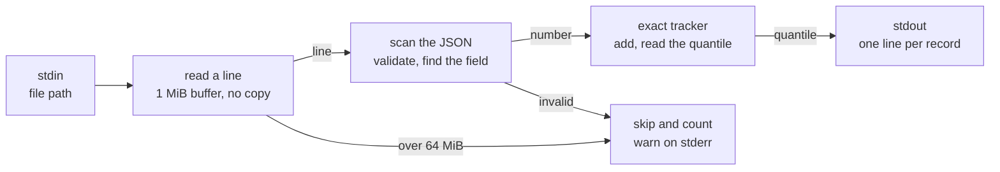

# running-quantile

[](https://github.com/vova-tarasov/running-quantile/actions/workflows/ci.yml)
[](https://github.com/vova-tarasov/running-quantile/actions/workflows/ci.yml)

A command-line tool that reads a JSON Lines file and, after every valid record, prints the **exact** q-quantile of
one numeric field over all the valid records so far. Written in Go 1.26 with the standard library only; it runs on
one CPU core at 500–700 MB/s.

## How it works



- Each line is checked against the full JSON grammar in one pass, without allocating memory. A record that is
  broken, lacks the field or holds something other than a number is skipped and reported, never fatal.
- The quantile is exact: linear interpolation between the two nearest values, the default in numpy and R. The
  tracker stores each distinct value once with a count, and switches to two heaps at 8 bytes per value once
  that costs no more memory, which happens when about one value in six or more is new.

The full explanation, with more diagrams, is in [docs/how-it-works.md](docs/how-it-works.md).

## Usage

Download a binary for Linux, macOS or Windows from the
[latest release](https://github.com/vova-tarasov/running-quantile/releases/latest), or build it with Go 1.26;
there are no other dependencies:

```sh
make build        # or: go build -o running-quantile .
```

Pass the quantile and the field as arguments, and the file's path on stdin:

```sh
echo /path/to/file.jsonl | ./running-quantile <q> <field>
```

### The example from the task

```sh
cat > /tmp/example.jsonl <<'EOF'
{"timestamp": "2026-06-18T10:00:01Z", "customer_id": "acme", "region": "us-east", "endpoint": "/api/v1/query", "latency_ms": 5, "bytes_sent": 8421}
{"timestamp": "2026-06-18T10:00:02Z", "customer_id": "acme", "region": "us-east", "endpoint": "/api/v1/query", "latency_ms": 3, "bytes_sent": 9102}
{"timestamp": "2026-06-18T10:00:03Z", "customer_id": "acme", "region": "us-west", "endpoint": "/api/v1/insert", "latency_ms": 8, "bytes_sent": 8950}
{"timestamp": "2026-06-18T10:00:04Z", "customer_id": "globex", "region": "us-east", "endpoint": "/api/v1/query", "latency_ms": 1, "bytes_sent": 7200}
{"timestamp": "2026-06-18T10:00:05Z", "customer_id": "acme", "region": "us-east", "endpoint": "/api/v1/query", "latency_ms": 9, "bytes_sent": 5600}
{"timestamp": "2026-06-18T10:00:06Z", "customer_id": "globex", "region": "us-west", "endpoint": "/api/v1/insert", "latency_ms": 4, "bytes_sent": 7800}
EOF
echo /tmp/example.jsonl | ./running-quantile 0.75 latency_ms
```

```
5
4.5
6.5
5.75
8
7.25
```

### Other quantiles and fields

```sh
echo /tmp/example.jsonl | ./running-quantile 0.5 latency_ms                # running median:  5 4 5 4 5 4.5
echo /tmp/example.jsonl | ./running-quantile 1 bytes_sent                  # running maximum: 8421 9102 9102 9102 9102 9102
echo /tmp/example.jsonl | ./running-quantile 0.99 latency_ms | tail -n 1   # final p99 only:  8.95
```

### Bad records are skipped

```sh
cat > /tmp/messy.jsonl <<'EOF'
{"latency_ms": 12}
{"latency_ms": 7
{"region": "us-east"}
{"latency_ms": "15"}

{"latency_ms": 20}
EOF
echo /tmp/messy.jsonl | ./running-quantile 0.5 latency_ms
```

stdout gets one line per valid record:

```
12
16
```

stderr names the first 10 skipped records with their line numbers, then the total. The blank line is ignored, and
the exit code stays 0:

```
line 2: malformed JSON
line 3: missing field "latency_ms"
line 4: field "latency_ms" is not a number
skipped 3 invalid records
```

### Exit codes

| Code | When |
|---|---|
| 0 | success, even if records were skipped |
| 1 | no usable path on stdin, the file can't be opened or read, or stdout can't be written |
| 2 | bad arguments, for example `q` outside [0, 1] |

## Benchmarks

Apple M4, Go 1.26.0, one core.

| Per record | Time |
|---|---|
| Scan the task's 147-byte record: validate it, find the field | 130 ns, 0 allocations |
| Add the value to the tracker and read the quantile (few distinct values) | 22 ns |
| Format the quantile | 21 ns |
| The whole pipeline, 1M records held in memory | 218 ns, 704 MB/s |

A 24 GB file of 128M records, generated and checked by `make stress`:

| Field and q | Values | Time | Throughput | Peak memory |
|---|---|---|---|---|
| `latency_ms`, 0.99 | integers, few distinct | 34.1 s | 704 MB/s | 8.6 MiB |
| `duration_us`, 0.5 | random floats, all distinct | 48.7 s | 493 MB/s | 981 MiB |

An exact answer needs every distinct value, so 128M distinct floats take at least 977 MiB; the whole process
peaks at 8.04 bytes per value. How these were measured, and more numbers, are in
[docs/how-it-works.md](docs/how-it-works.md#performance-and-memory).

## Development

```sh
make test     # gofmt check, go vet, all tests (about 1 s)
make cover    # coverage report; fails if any function except main is below 100%
make bench    # benchmarks
make fuzz     # fuzz the scanner, the trackers and the pipeline (FUZZTIME=60s by default)
make stress   # on-demand 24 GB test, about 2 minutes
```
