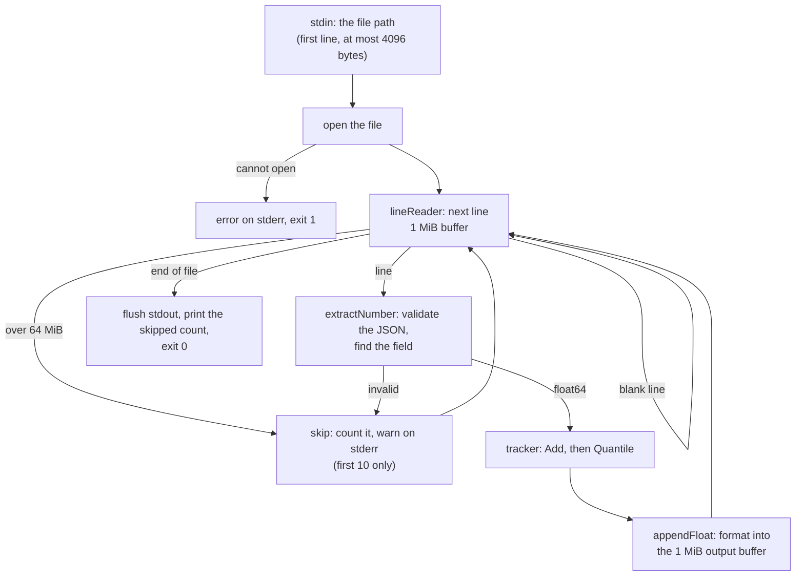
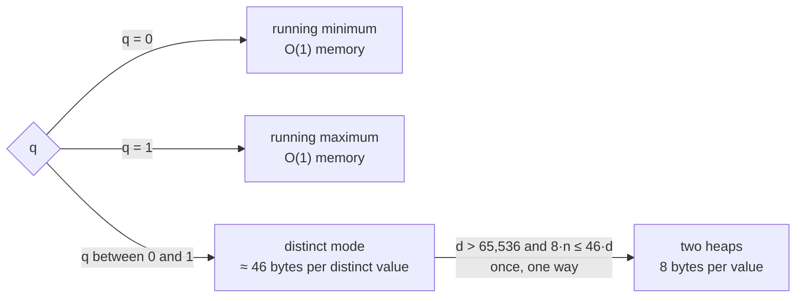
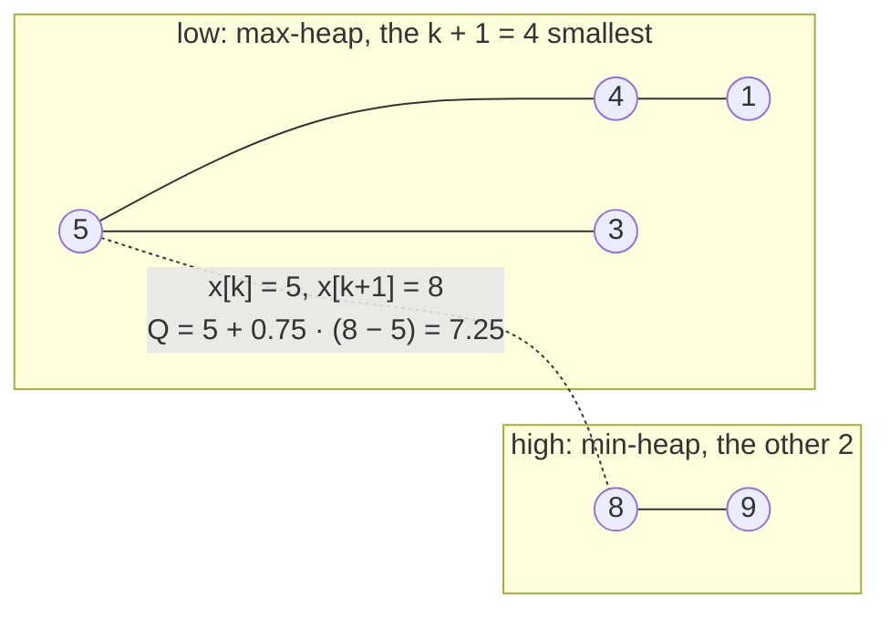
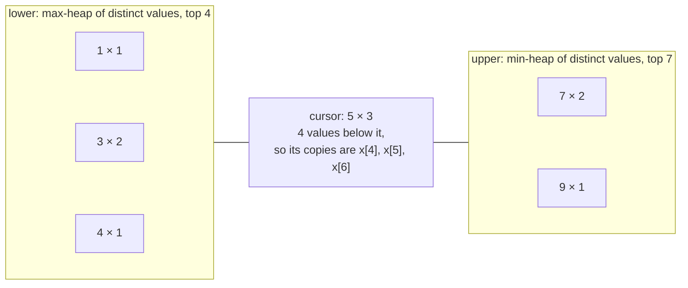
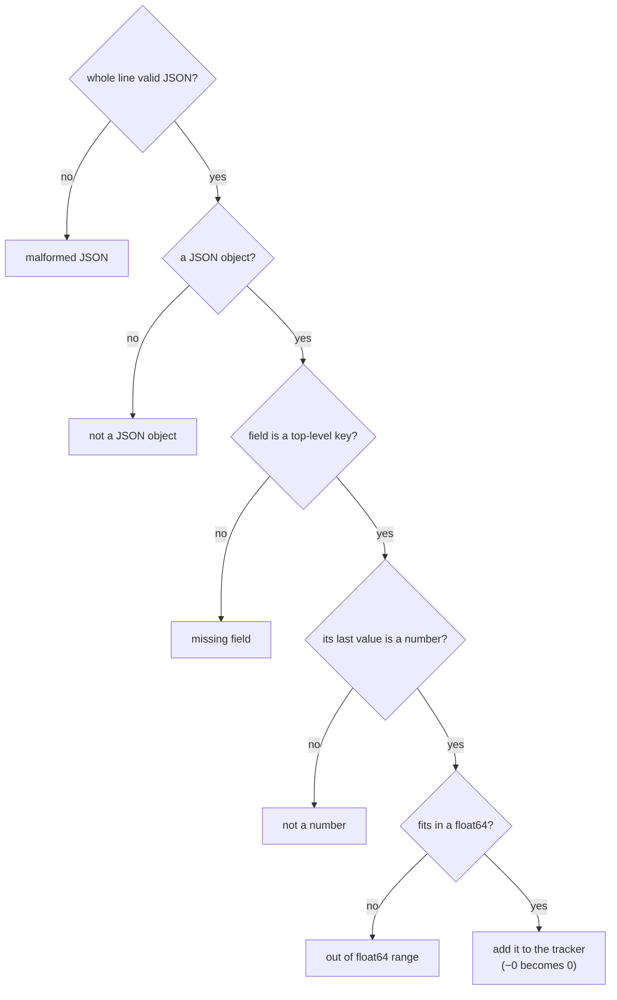
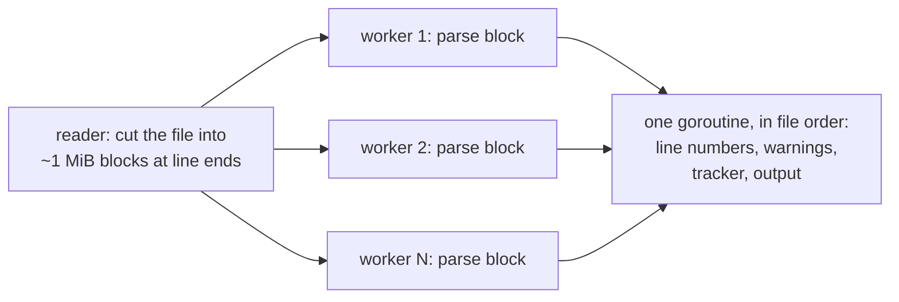

# How running-quantile works

This document explains the design of `running-quantile` in detail. The [README](../README.md) has the short
version: what it does, how to run it, and the headline numbers.

**Contents**

1. [In short](#in-short)
2. [The quantile](#the-quantile)
3. [The life of one record](#the-life-of-one-record)
4. [Exact answers with little memory](#exact-answers-with-little-memory)
5. [Reading one line](#reading-one-line)
6. [Input and output rules](#input-and-output-rules)
7. [Numerics](#numerics)
8. [Performance and memory](#performance-and-memory)
9. [Building and testing](#building-and-testing)
10. [Possible extensions](#possible-extensions)

## In short

- The program streams the file once, line by line, on a single goroutine. Nothing about earlier records is kept
  except what the quantile needs.
- Every line is fully validated as JSON by a hand-written scanner that allocates no memory. Broken records are
  skipped and reported; they never stop the run.
- The answer is exact. For q = 0 and q = 1 that takes O(1) memory. For any other q the tracker keeps one count per
  distinct value, and moves to two heaps of 8 bytes per value once that
  costs no more memory, which happens when about one value in six or more is new.
- Output is formatted the way `encoding/json` prints a float64 and written through a 1 MiB buffer.
- On an Apple M4 it processes 500–700 MB/s of JSON Lines. A 24 GB file of 128M records takes 34–49 s.

## The quantile

For the n values seen so far, sorted as x[0] ≤ x[1] ≤ … ≤ x[n−1]:

```
h = (n − 1) · q
k = floor(h)
f = h − k
Q = x[k] + f · (x[k+1] − x[k])      (Q = x[k] when f = 0)
```

This is linear interpolation between the two nearest order statistics: Hyndman and Fan's type 7, the default of
numpy (`method="linear"`) and R (`type = 7`). q = 0 gives the minimum and q = 1 the maximum.

**Why type 7.** It is the only common definition that reproduces the task's example. For the second record, the
values are 3 and 5 and q = 0.75. Type 7 gives 3 + 0.75 · (5 − 3) = 4.5, as the task expects; the other eight
Hyndman–Fan definitions give 4 or 5.

The whole example, with q = 0.75 and the field `latency_ms`:

| Record | Value | Sorted so far | h = (n − 1) · 0.75 | Output |
|---|---|---|---|---|
| 1 | 5 | 5 | 0 | 5 |
| 2 | 3 | 3 5 | 0.75 | 3 + 0.75 · (5 − 3) = 4.5 |
| 3 | 8 | 3 5 8 | 1.5 | 5 + 0.5 · (8 − 5) = 6.5 |
| 4 | 1 | 1 3 5 8 | 2.25 | 5 + 0.25 · (8 − 5) = 5.75 |
| 5 | 9 | 1 3 5 8 9 | 3 | 8 |
| 6 | 4 | 1 3 4 5 8 9 | 3.75 | 5 + 0.75 · (8 − 5) = 7.25 |

The program never sorts. It only needs x[k] and x[k+1], and k moves by at most one per record, so the trackers
below keep those two values at hand.

## The life of one record



1. **The path.** Only the first line of stdin is read, at most 4096 bytes, and the program goes on as soon as
   that line ends. Typing a path by hand works without closing stdin.
2. **Reading.** A `bufio.Reader` with a 1 MiB buffer returns each line as a slice of its buffer (`ReadSlice`), so
   lines up to 1 MiB are never copied. Longer lines are assembled in a reused side buffer, up to a cap of 64 MiB.
   Beyond the cap the rest of the line is read and dropped without being stored, so one huge line can't exhaust
   memory.
3. **Scanning.** A hand-written scanner checks the whole line against the JSON grammar and finds the field's
   value. See [Reading one line](#reading-one-line).
4. **Tracking.** The value is added to the tracker, which returns the current quantile. See
   [Exact answers with little memory](#exact-answers-with-little-memory).
5. **Writing.** The quantile is formatted straight into the free space of a 1 MiB `bufio.Writer`
   (`AvailableBuffer`), so nothing is allocated. If a write fails, the program stops at once.

The line reader, the scanner and the formatter are each tested to allocate nothing per record. One goroutine does
all of it, which is the least CPU work per record; a multi-core design is sketched under
[Possible extensions](#possible-extensions).

## Exact answers with little memory

Any value seen so far can become the quantile later, so an exact answer needs Ω(n) memory in general. The
trackers keep that memory as small as the data allows.

### Choosing a tracker



Here n is the number of values and d the number of distinct values so far.

| q | Structure | Memory | Time per record |
|---|---|---|---|
| 0 | running minimum | O(1) | O(1) |
| 1 | running maximum | O(1) | O(1) |
| other, few distinct values | distinct mode: a count per distinct value, plus two heaps of the distinct values | about 46 bytes per distinct value | O(log d), amortized (map growth) |
| other, many distinct values | two heaps of all values | 8 bytes per value | O(log n) |

Reading the quantile is O(1) in every mode. Scanning a record is O(length of the line), with O(1) memory beyond
the buffers.

### Two heaps

A max-heap `low` holds the k + 1 smallest values and a min-heap `high` holds the rest. The top of `low` is then
x[k] and the top of `high` is x[k+1].

The task's example after the sixth record (n = 6, q = 0.75, so k = 3):



- **Add** pushes the value onto the heap it belongs to, then moves tops from one heap to the other until `low`
  holds exactly k + 1 values for the new n. In the example, 4 went into `low`, which then held 5 values; for n = 6
  it may hold only 4, so its top, 8, moved to `high`. k = floor((n − 1) · q) grows by at most one per record, so
  that is at most one move and Add is O(log n). Float64 rounding could in principle make k jump by two, so the code
  loops instead of assuming a single move.
- **Quantile** reads the two tops and interpolates: O(1).
- **Storage.** The heaps keep each value once, as a float64, in fixed-size chunks of 64 KiB (8192 values) instead
  of one growing slice. A slice that grows copies everything into a bigger array and leaves the old one as
  garbage; chunks are allocated once and never copied, so memory stays at about 1× the data. A test checks that
  2^20 pushes allocate at most 1.1× the bytes stored. `container/heap` is not used, because it boxes every value
  in an interface.

### Distinct mode

Real metrics repeat. A latency in whole milliseconds takes about a thousand different values even over a
hundred million records, so storing every copy would waste memory. For 0 < q < 1 the tracker therefore starts by storing
each distinct value once, with a count.

An example with 10 values and q = 0.75 (h = 6.75, so k = 6 and f = 0.75):



x[6] is a copy of the cursor, 5. x[7] is not, so it is the top of `upper`, 7. The quantile is
5 + 0.75 · (7 − 5) = 6.5.

- Each distinct value is stored once with a count in a `map[float64]int`. A cursor marks the distinct value that
  holds x[k], together with its count and `below`, the number of values smaller than it.
- Distinct values below the cursor sit in a max-heap and larger ones in a min-heap, so moving the cursor one
  distinct value is one pop and one push. Add is O(log d).
- Memory follows d, not n: about 46 bytes per distinct value (`bytesPerDistinct`). It was measured by adding 1M
  distinct values to a distinct tracker and taking the live heap after a GC: 45.85 B per value, rounded up.
  (`TotalAlloc` says 83.65 B, because it also counts the map tables discarded as the map grows.)
- The results are bit-for-bit identical to the two-heap tracker after every record; the tests check exactly that.

### When to switch to heaps

After each Add the tracker checks, in O(1):

```
switch when d > distinctFloor and 8 · n ≤ bytesPerDistinct · d       (distinctFloor = 65,536, bytesPerDistinct = 46)
```

That is, it switches when storing every value (8 B each) would cost no more than the distinct structure.

- **The floor** of 2^16 distinct values keeps small inputs from ever paying for a switch. It is a judgment call,
  not tuned by measurement: it lets distinct mode grow to about 3 MB (2^16 × 46 B) before heaps are considered.
- **The switch** is one O(n) pass. The cursor value's copies up to rank k go to `low`, everything else to `high`,
  and both heaps are heapified. While it runs, both structures exist, so memory briefly peaks at about 2× the
  distinct structure.
- **It is one-way.** Once on heaps, the tracker never returns to distinct mode.

The two fields of the 24 GB test show both outcomes:

| Field | Values | What happens |
|---|---|---|
| `duration_us` | random floats, every value new | d = n, so the switch happens at the 65,537th value; from then on 8 B per value |
| `latency_ms` | `int(exp(3 + 0.8·N(0,1)))`, whole milliseconds | about 973 distinct values expected after 128M records (computed from the distribution), about 45 KB; it never switches |

## Reading one line

Parsing JSON is most of the work, so the scanner is written by hand. It makes one pass over the line, validates
the whole line against the JSON grammar (RFC 8259), and remembers where the value of the last top-level key equal
to the field is. On the task's 147-byte record it takes about 130 ns and allocates nothing.

After the pass, the first failing check decides why a record is skipped. A broken line is reported as broken even
if it also lacks the field:



- **Keys** are matched the way `encoding/json` decodes them. A key's plain ASCII bytes are compared with the field
  directly, stopping at the first difference. From the first backslash or non-ASCII byte on, the rest of the key
  is decoded as it is compared: escapes, surrogate pairs, and U+FFFD for lone surrogates and invalid UTF-8.
- **Only top-level keys count.** Nested objects and arrays are validated and skipped, and keys inside them never
  match. Nesting is capped at 10,000 levels, the same limit as `encoding/json`, so recursion can't overflow the
  stack.
- **Duplicate keys:** the last occurrence wins, as in `encoding/json`.
- **Numbers.** An integer of at most 15 digits, with no fraction or exponent, is converted directly. That is exact,
  because 10^15 < 2^53, so it gives the same float64 as `strconv.ParseFloat`. Any other number goes to
  `strconv.ParseFloat`.

A field name that needs escaping or is not ASCII matches its key in any spelling:

| Field argument | Matching keys |
|---|---|
| `v` | `"v"`, `"\u0076"` |
| `café` | `"café"`, `"caf\u00e9"` |
| `😀` | `"😀"`, `"\ud83d\ude00"` |
| `lat"ency` | `"lat\"ency"`, `"lat\u0022ency"` |

A key that only looks similar never matches: `{"x":{"v":1}}` (nested), `{"note":"\"v\": 5"}` (inside a
string), `{"vv":1}` and `{"V":1}` are all `missing field "v"`. Numeric strings such as `"5"` are not numbers.

## Input and output rules

### Running it

```
echo /path/to/file.jsonl | running-quantile <q> <field>
```

- The path is read from the **first line** of stdin.
  - Only the trailing `\n` or `\r\n` is removed. Other whitespace is kept, because it can be part of
    a path.
  - Anything after the first line of stdin is ignored, and the program does not wait for it.
  - At most 4098 bytes of stdin are read. A first line longer than 4096 bytes is an error.
- A relative path is accepted (relative to the working directory), even though the task says the path is absolute.
- Output: one line on stdout per **valid** record.

### Arguments

| Case | Result |
|---|---|
| Not exactly 2 arguments | error and usage on stderr, exit 2, stdin is not read |
| `q` is not a JSON-style decimal number (grammar: `-?(0\|[1-9][0-9]*)(\.[0-9]+)?([eE][+-]?[0-9]+)?`) | error and usage, exit 2 |
| `q` outside [0, 1] (e.g. `1.1`, `-0.1`, `1e400`) | error and usage, exit 2 |
| `q` given as `NaN`, `Inf`, hex (`0x1p-2`), underscores (`1_0`), `.5`, `+0.5`, or with surrounding spaces | error and usage, exit 2 (they fail the grammar) |
| `q` = `-0` | accepted, treated as 0 |
| `q` like `1e-1`, `0.75`, `1`, `0` | accepted |
| Empty field name `""` | error and usage, exit 2 (so a JSON key `""` can't be selected; deliberate) |

`q` uses the same number grammar as JSON, so the rule is short and easy to explain. Go's `strconv.ParseFloat` on
its own would also accept hex, underscores, `inf` and `nan`, so `q` is accepted only if it matches the grammar
and `ParseFloat` accepts it.

The field name is a literal top-level key: `a.b` is the key `a.b`, not a nested path.

### The input file and its records

| Case | Treatment |
|---|---|
| Empty stdin, or an empty first line | error on stderr, exit 1 |
| First line of stdin longer than 4096 bytes | error on stderr, exit 1 |
| The JSON Lines content piped in instead of its path (`cat file.jsonl \| running-quantile …`) | its first line is not a file that can be opened (or is too long): error on stderr, exit 1 |
| Path that doesn't exist, can't be read, or is a directory | error on stderr, exit 1 (a directory fails at its first read: `reading line 1: …`) |
| Read error in the middle of the file | the output so far is flushed, then `error: reading line N: …` on stderr, exit 1 |
| Empty file, or no valid records | no stdout, exit 0 (plus the skipped count if > 0) |
| Blank or whitespace-only line (only spaces, tabs and CRs) | ignored silently, not counted as skipped; it still counts in the line numbers |
| CRLF line endings, UTF-8 BOM at the start of line 1, no final newline | accepted (a BOM at the start of any other line is `malformed JSON`) |
| Invalid JSON (truncated, trailing garbage, `NaN`/`Infinity`, leading zeros `05`, `+5`, `.5`, `1.`, control characters inside strings, bad escapes) | **skipped** (`malformed JSON`) |
| Nesting deeper than 10,000 levels (the top-level object is level 1) | **skipped** (`malformed JSON`) |
| Valid JSON that isn't an object (`[1]`, `5`, `"x"`, `null`) | **skipped** (`not a JSON object`) |
| Field absent (the match is top-level, exact, case-sensitive, after unescaping) | **skipped** (`missing field "<f>"`) |
| Field is not a number (`"5"`, `true`, `null`, `[]`, `{}`) | **skipped** (`field "<f>" is not a number`) |
| Number beyond float64 (`1e400`) | **skipped** (`field "<f>" is out of float64 range`) |
| Number that underflows (`1e-400`) | accepted as 0 (this is `strconv.ParseFloat` behaviour) |
| Integers above 2^53 | accepted, rounded to the nearest float64 (`9007199254740993` becomes `9007199254740992`) |
| `-0` | accepted as 0, so `-0` is never printed |
| Duplicate keys | the **last** occurrence wins; if the last one isn't a number, the record is skipped |
| Invalid UTF-8 bytes inside strings | tolerated (same as `encoding/json`) |
| Line longer than 64 MiB | **skipped** (`line too long (over 64 MiB)`) without buffering it: the rest of the line is drained in place |

### Warnings and errors

All diagnostics go to stderr:

- Every skipped record gets a warning `line N: <reason>`, where N is the 1-based physical line number, for the
  first 10 skipped records only.
- At the end, if any record was skipped: `skipped K invalid record` (K = 1) or `skipped K invalid records`.
  Skipped records never change the exit code.
- Bad arguments: `error: <message>`, then the usage line.
- I/O errors: `error: <message>`, after the skipped count if there is one.

The reasons are `malformed JSON`, `not a JSON object`, `missing field "<f>"`, `field "<f>" is not a number`,
`field "<f>" is out of float64 range` and `line too long (over 64 MiB)`.

### Output format

- Numbers are printed exactly the way `encoding/json` prints a float64:
  - `strconv.AppendFloat(v, 'f', -1, 64)` (the shortest decimal that round-trips, with no exponent) when
    1e-6 ≤ |v| < 1e21 or v = 0;
  - otherwise the exponent form, cleaned up the same way: `1e-7`, `5e-324`, `1e+21`.
- So typical metrics print as `5`, `4.5` or `1234567`, and extreme values don't print as 300-digit strings.
- Output is buffered (1 MiB). It is flushed at the end, also after a read error, so the output for the records
  before the error is kept.
- When a write fails, the program stops at once instead of reading the rest of the input. If stdout is a pipe
  whose reader has gone away (`… | head -n 1`), the process ends with SIGPIPE, like other Unix tools. Any other
  write error is `error: …` with exit 1.

### Exit codes

| Code | Meaning |
|---|---|
| 0 | success, including when records were skipped |
| 1 | I/O error (stdin, open, read, or write) |
| 2 | bad arguments |

## Numerics

- **h is computed in float64.** `(n − 1) · q` can land just below an integer. For the values 0 … 100 and
  q = 0.29, h = 100 · 0.29 = 28.999999999999996, so k = 28 and f ≈ 1, and the program prints
  `28.999999999999996` where exact arithmetic gives 29. A result can therefore differ from other tools in the
  last digits.
- **The same output on every platform.** Go may fuse a multiplication and the addition after it into one FMA
  instruction, which rounds once instead of twice. It does so on arm64 (and on amd64 with `GOAMD64=v3`). So
  `rank` and `lerp` round each product to float64 with an explicit conversion, which forbids the fusion. Without
  it, an arm64 build and an amd64 build disagreed in the last digit on 2–32% of 100,000 output lines at q = 0.1,
  0.29, 0.9, 0.95 and 0.99 (none at 0.5 and 0.75, where the products happened to be exact). With it, their output
  is identical. `TestRank` and `TestLerp` pin the rounded results, and they fail on arm64 without the conversions.
- **Integers above 2^53** are rounded to the nearest float64 when parsed. The quantile is exact for the parsed
  values.
- **Underflow.** A number too small for float64 (`1e-400`) becomes 0, as `strconv.ParseFloat` returns it. The
  smallest subnormal, `5e-324`, is kept.
- **Overflow.** A number beyond float64 (`1e400`) is skipped. In the interpolation, `x[k+1] − x[k]` can only
  overflow for values of opposite sign near ±MaxFloat64; then `(1 − f) · x[k] + f · x[k+1]` is used instead.
- **Negative zero.** `-0` is read as 0, so it is never printed.
- JSON has no NaN or infinity, so every value is finite and the ordering is total.

## Performance and memory

Measured on an Apple M4 (10 cores, 32 GB of RAM), macOS (Darwin 27.2), Go 1.26.0. The program runs on one core.

### Where the time goes

From the benchmark medians below:

| Part | ns per record | Benchmark |
|---|---|---|
| scanning the task's 147-byte record | 130 | `BenchmarkExtractNumber/pdf` |
| tracker Add + Quantile, few distinct values | 22 | `BenchmarkTrackerAdd`, distinct, ints |
| formatting the quantile | 21 | `BenchmarkAppendFloat` |
| the whole pipeline, 1M records from memory | 218 | `BenchmarkProcess` |

Scanning is about 60% of the time. The remaining ~45 ns go to splitting lines, the blank-line check and the
buffered write; they were not measured separately.

### The 24 GB runs

`make stress` writes a seeded file of 23,999,999,997 bytes with 128,312,439 lines:

- 128,055,557 valid records shaped like the task's example, plus a `duration_us` field that holds a random float
  (all distinct). `latency_ms` is `int(exp(3 + 0.8·N(0,1)))`, so it has few distinct values;
- 128,184 invalid lines (one in 1000), cycling through malformed JSON, not an object, missing field, not a number
  and out of float64 range;
- 128,698 blank lines (one in 997).

It runs the binary twice on that file, streams and checks its output, and logs the time. The file is read from
the page cache or the disk, and the test reads every output line through a pipe. The full test ran three times,
each time passing every check: twice when it was written (run 2 after the test began returning its reference
data to the OS before starting the binary), and once on the final code (run 3).

| Run | Field and q | Wall time | Throughput | Records/s | Peak RSS as read in the test |
|---|---|---|---|---|---|
| 1 | `latency_ms`, 0.99 | 34.2 s | 701 MB/s | 3.74 M | 7.5 MiB |
| 1 | `duration_us`, 0.5 | 49.1 s | 489 MB/s | 2.61 M | 462.6 MiB (too low, see below) |
| 2 | `latency_ms`, 0.99 | 33.7 s | 712 MB/s | 3.80 M | 7.5 MiB |
| 2 | `duration_us`, 0.5 | 48.8 s | 492 MB/s | 2.62 M | 507.5 MiB (too low, see below) |
| 3 | `latency_ms`, 0.99 | 34.1 s | 704 MB/s | 3.76 M | 7.4 MiB |
| 3 | `duration_us`, 0.5 | 48.7 s | 493 MB/s | 2.63 M | 486.0 MiB (too low, see below) |

The 24 GB `latency_ms` run takes 266 ns per line end to end, which includes reading the file and the pipe to the
test. The `duration_us` run takes 380 ns per line: its values take the `strconv.ParseFloat` path, its output
lines are longer, and its heaps grow to about 1 GB. These three causes were not measured separately.

**Memory.** The `duration_us` readings in the test are too low: 128M float64 values alone take 977 MiB. The
machine was already using 4 GB of swap, and the test adds 24 GB of file cache, plus about 3 GB of reference data
while it computes the expected output. So macOS compressed part of the binary's heap (about 928,000 page
compressions during run 3), and Maxrss does not count compressed pages. The true peak comes from running the
binary alone on the same file, with `echo <file> | /usr/bin/time -l ./running-quantile <q> <field> | tail -1`
(about 47,000 compressions during the `duration_us` run):

| Field and q | Max RSS | Peak memory footprint | Per value |
|---|---|---|---|
| `latency_ms`, 0.99 | 8.6 MiB | 7.1 MiB | (distinct mode: memory follows the distinct values) |
| `duration_us`, 0.5 | 981.4 MiB | 988.5 MiB | 8.04 B (Max RSS) |

The peak memory footprint is macOS's count that includes compressed pages. A standalone run while the stress
test was being written gave 988.6 MiB of Max RSS for `duration_us`. The stress test asserts at most 64 MiB for
`latency_ms` (storing every value would take 977 MiB) and at most 8·n·1.25 + 64 MiB = 1285.2 MiB for
`duration_us`, and it logs a note when the `duration_us` reading is below 8 bytes per value.

On Linux, in a linux/arm64 container on the same M4, `RQ_STRESS_BYTES=3000000000 make stress` (16,006,870 valid
records) passes with 703 MB/s and 4.9 MiB for `latency_ms`, and 523 MB/s and 127.9 MiB for `duration_us`
(8.4 B per value, including the runtime and buffers). GNU `time` reports 127.4 MiB for the binary on 16,006,870
other random values.

### Benchmarks

`make bench` runs these benchmarks:

- `BenchmarkExtractNumber`: one record, either the task's 147-byte example line (`pdf`) or the same line with the
  `latency_ms` key written with an escape (`escaped-key`), which takes the decoding path.
- `BenchmarkAppendFloat`: formatting a cycle of typical quantiles.
- `BenchmarkTrackerAdd`: Add plus Quantile at q = 0.5, on random floats (all distinct) and on ints 0..999. Each
  tracker grows from 0 to 2^20 values and is then replaced.
- `BenchmarkProcess`: the whole pipeline over 1M records shaped like the task's example (153 MB, held in memory),
  on `latency_ms`.

Absolute numbers drift by about 2% between sessions. For example, `BenchmarkExtractNumber/pdf` before the
performance pass read 148.2 ns in one session and 151.3 ns in another. So compare numbers within one table only.

### How the constants were tuned

Each number is a median. For the buffer sizes it is the median of 6 runs per size. The buffer sizes were also
checked end to end: the binary on a 1.53 GB file of 10M such records (warm page cache, stdout to `/dev/null`),
7 alternating runs each. Every other before/after pair comes from two test binaries run alternately, 10 runs
each, so drift affects both sides equally. Each change was measured on top of the ones kept before it.

| Change | Before | After | Kept? |
|---|---|---|---|
| `readBufSize` 64 KiB / 256 KiB / **1 MiB** / 4 MiB | `BenchmarkProcess`: 240.8 / 241.9 / 241.2 / 242.2 ns per record; binary: 2.501 / 2.496 / 2.495 / 2.493 s | (same) | no difference beyond noise; 1 MiB stays, so lines up to 1 MiB are never copied |
| `writeBufSize` 64 KiB / 256 KiB / **1 MiB** / 4 MiB | `BenchmarkProcess`: 241.5 / 241.9 / 242.2 / 241.7 ns per record; binary: 2.490 / 2.488 / 2.492 / 2.493 s | (same) | no difference beyond noise; 1 MiB stays |
| `chunkBits` 12 / **13** / 14 / 16 | see the next table | (same) | 13 stays |
| Integer fast path: an integer of up to 15 digits is converted without `strconv.ParseFloat` | `pdf` 151.3 ns, `escaped-key` 175.2 ns, `BenchmarkProcess` 242.3 ns per record | 144.2 ns, 167.6 ns, 231.9 ns | yes |
| `keyEquals` in one loop: compare plain ASCII bytes with the field as they are scanned, stop at the first difference | `pdf` 144.2 ns, `escaped-key` 168.5 ns, `BenchmarkProcess` 231.5 ns per record | 131.0 ns, 155.0 ns, 217.2 ns | yes |
| `keyEquals` decodes from the end of the matching ASCII prefix instead of from the start of the key | `pdf` 130.8 ns, `escaped-key` 154.6 ns | 130.9 ns, 139.4 ns | yes |

`chunkBits`, `BenchmarkTrackerAdd` in ns per Add + Quantile (10 alternating runs each):

| | 12 | **13** | 14 | 16 |
|---|---|---|---|---|
| heaps, random | 58.2 | 59.1 | 59.4 | 58.3 |
| heaps, ints | 56.5 | 57.3 | 57.4 | 56.7 |
| distinct, random | 125.1 | 128.0 | 125.6 | 123.8 |
| distinct, ints | 22.4 | 22.3 | 22.3 | 22.2 |
| adaptive, random | 65.3 | 65.9 | 64.9 | 62.2 |
| adaptive, ints | 24.0 | 23.9 | 23.9 | 24.0 |

Only 16 was clearly faster, and only on adaptive/random (−6%). But at 14 and 16 the first chunk of each of a
distinct tracker's two heaps is 128 KiB or 512 KiB, so 100 distinct values take more than the 256 KiB that
`TestDistinctMemoryFollowsDistinctValues` allows. 13 stays.

Before and after the whole pass. The first four rows are medians of 6 runs of `make bench` at the start and at
the end (and the binary row as above). The last two rows come from 10 alternating runs of the two versions:

| Benchmark | Before | After |
|---|---|---|
| `BenchmarkExtractNumber/pdf` | 148.2 ns, 0 allocs | 130.1 ns, 0 allocs |
| `BenchmarkExtractNumber/escaped-key` | 173.3 ns, 0 allocs | 139.1 ns, 0 allocs |
| `BenchmarkProcess` | 241.1 ns per record, 635 MB/s | 217.7 ns per record, 704 MB/s |
| binary, 1.53 GB file of 10M records | 2.492 s | 2.230 s (same output) |
| `BenchmarkAppendFloat` | 21.3 ns | 21.3 ns |
| `BenchmarkTrackerAdd`: heaps random, ints; distinct random, ints; adaptive random, ints | 61.1, 56.2, 126.9, 22.6, 64.7, 24.2 ns | 61.3, 57.9, 126.5, 22.3, 65.2, 23.8 ns |

The formatter and the trackers did not change, and their numbers differ only by noise. `BenchmarkProcess` makes
27 allocations per run of 1M records, and `TestProcessAllocationsDoNotGrowWithRecords` checks that 101k records
make at most 10 more allocations than 1k records.

The explicit float64 rounding in `rank` and `lerp` (see [Numerics](#numerics)) came after this pass. Five
alternating runs of each version show no difference beyond noise:

| Benchmark | Fused (before) | Rounded (after) |
|---|---|---|
| `BenchmarkProcess` | 217.3 ns per record | 216.4 ns per record |
| `BenchmarkTrackerAdd`: heaps random, ints; distinct random, ints; adaptive random, ints | 59.6, 56.5, 125.8, 22.0, 64.7, 24.1 ns | 57.8, 56.7, 127.0, 21.8, 64.8, 23.6 ns |

The chosen constants:

| Constant | Value |
|---|---|
| `readBufSize` | 1 MiB |
| `writeBufSize` | 1 MiB |
| `chunkBits` | 13 (8192 values, 64 KiB per chunk) |
| `maxSmallIntDigits` | 15 |
| `distinctFloor` | 2^16 |
| `bytesPerDistinct` | 46 |

## Building and testing

It needs Go 1.26 and nothing else: there are no dependencies, so `go build` is the whole build. It was developed
with Go 1.26.0 on macOS (arm64) and checked on Linux (arm64 and amd64) with the `golang:1.26` Docker image. The
Makefile uses only POSIX make, shell and awk features, and works when recipes run under `sh -e`, as POSIX make runs
them. It was run with GNU make 3.81 (macOS) and 4.4.1 (Linux), and with 4.4.1 in `.POSIX` mode; BSD make was not
tried.

| Command | What it does |
|---|---|
| `make build` | builds `./running-quantile` (`go build -o running-quantile .`) |
| `make test` | fails if a file needs `gofmt`, runs `go vet` (also with the `stress` build tag), then `go test ./...` (about 1 s of tests) |
| `make cover` | runs the tests with a coverage profile, writes the coverage of every function to `coverage.txt` and prints it, and fails if any function except `main` is below 100.0% |
| `make bench` | runs the benchmarks |
| `make fuzz` | runs each of the three fuzz targets for `FUZZTIME`, 60 s by default (`make fuzz FUZZTIME=10m`) |
| `make stress` | runs the on-demand stress test: a seeded file of up to 24 GB, two runs of the binary, about 2 minutes on an M4 |
| `make clean` | removes the binary and the coverage files |

The stress test writes its file to the temporary directory (`TMPDIR` picks another one) and deletes it afterwards.
At the full 24 GB it needs 24 GB of free disk, and about 3 GB of memory for the reference values in the test
process. `RQ_STRESS_BYTES` sets a smaller size, from 1 to 24000000000 bytes: `RQ_STRESS_BYTES=200000000 make stress`
took 1.4–1.7 s in three runs on the M4.

**Continuous integration.** On every push to `main` and every pull request, GitHub Actions runs `make test` and
`make cover` on Ubuntu and on macOS. After a green run on `main`, it writes the total coverage to `coverage.json`
on the `badges` branch, which the README's coverage badge reads.

### What the tests cover

`make test` runs every suite below except the coverage gate, the Linux runs and the stress test; the fuzz targets
run only their seed corpus there. All tests use only the standard library. `make test` runs 55 test functions and
the seed corpora of 3 fuzz targets. Besides those, `TestMain` builds the binary, and the stress-tagged
`TestStress24GB` runs only under `make stress`. There are 4 benchmarks.

- **Trackers against a reference** (`quantile_test.go`, `distinct_test.go`, `heap_test.go`).
  - Every tracker is checked bit for bit, after every Add, against a reference that sorts a copy and applies
    type 7.
  - Inputs: normal random floats, small ints with many duplicates, ascending, descending, constant, mixed signs,
    and ±MaxFloat64 mixed with small values.
  - q = 0, 5e-324, 0.01, 0.25, 0.5, 0.75, 0.99, 0.9999999999999999, 1, and one seeded random q.
  - The distinct and adaptive trackers are also checked bit for bit against the heap tracker. That includes the
    Add that triggers the switch, and a switch while the copies of the cursor value straddle the two heaps.
  - The heaps pop in sorted order across chunks, heapify correctly, and grow without copying.
- **Scanner** (`scan_test.go`): valid records, including unusual number spellings (`1E+2`, `-0.0`, `0e0`,
  `1e-400`, `9007199254740993`, a 300-digit integer, `5e-324`); every skip reason; the nesting limit, exactly
  where `encoding/json` puts it; the warning texts; the JSON number grammar used for `q`; key decoding (escapes,
  surrogate pairs, invalid UTF-8); and keys that need escapes or are not ASCII.
- **Formatting** (`format_test.go`): fixed examples, and random values compared with `json.Marshal`.
- **Input** (`input_test.go`): the rules for the path line, the 4098-byte read limit, and returning as soon as the
  path line ends instead of waiting for the end of stdin; line splitting, CR removal, lines longer than the buffer,
  a line over the cap that is dropped without being buffered, and read errors.
- **Fuzzing** (`scan_fuzz_test.go`, `fuzz_test.go`):
  - `FuzzExtractNumber` compares the scanner with an oracle built from `encoding/json` (`json.Valid`, then
    `Unmarshal` into `map[string]json.RawMessage`, then `strconv.ParseFloat`). For any line and field, both must
    give the same verdict and the same value bits.
  - `FuzzTrackers` checks the adaptive tracker (with a floor of 8 distinct values, so it can switch early), the
    default tracker and the heap tracker bit for bit against an exact sorted reference. The values are int16, so
    there are many duplicates.
  - `FuzzProcess` checks that the pipeline never fails or panics on arbitrary bytes, and writes exactly one
    parsable number per valid record. For the first 2000 valid records, each number must be the median of the
    valid values so far, formatted by `appendFloat`, so scanner, tracker and formatter are checked together.
- **End to end** (`main_test.go`, `pipeline_test.go`): `run(args, stdin, stdout, stderr)` with in-memory streams.
  - The task's example.
  - Every rejected argument list, with the exact error and usage, without reading stdin.
  - Each skip reason with its exact warning and count, and the cap of 10 warnings.
  - CRLF, the BOM, blank lines, an empty file, long lines, and `-0`.
  - Every input error: a missing file, a directory, an unreadable file, JSON Lines content piped in instead of a
    path, and a 4 MiB first line.
  - A relative path, and a failing stdout.
  - In `process`: a read error in the middle of the file, and stopping at the first write error (it reads less
    than 8 MiB of a 16 MB input).
- **Binary** (`binary_test.go`): the real binary is built once into a temporary directory and run as a
  subprocess. The tests cover the task's example through the real stdin, exit codes 1 and 2, and stopping early
  when stdout is closed: with ~24 MB of output to write, the binary must die of SIGPIPE within 10 s.
- **Allocation and memory gates**:
  - no allocations in the scanner (plain and escaped keys), the formatter and the line reader;
  - `process` makes at most 10 more allocations for 101k records than for 1k records, and every record must be
    valid;
  - heap growth allocates at most 1.1× the bytes stored;
  - 1M records of 100 distinct values take at most 256 KiB;
  - q = 0 and q = 1 allocate at most 1 KiB for 1M values;
  - a 32 MiB line over the cap is dropped without being buffered.
- **Doc gate** (`doc_test.go`): it parses every `.go` file, including test and build-tagged files, and fails if a
  function or method has no doc comment that starts with its name.
- **Coverage gate** (`make cover`): 100.0% of the statements in every function except the one-line `main`
  (99.7% in total).
- **Linux**: besides CI, `make test` passes locally in the `golang:1.26` image, natively on linux/arm64 and under
  emulation on linux/amd64:

  ```
  docker run --rm -v "$PWD":/src -w /src golang:1.26 make test
  docker run --rm --platform linux/amd64 -v "$PWD":/src -w /src golang:1.26 make test
  ```

  The container runs as root, so the unreadable-file case is skipped (root can read a file with mode 000). With
  `--user 1000:1000 -e HOME=/tmp -e GOCACHE=/tmp/gocache -e GOPATH=/tmp/gopath` added, it runs and passes on both.
- **Stress** (`stress_test.go`, build tag `stress`, `make stress`): the 24 GB file described under
  [Performance and memory](#performance-and-memory). For each run it checks:
  - exit code 0;
  - one output line per valid record;
  - the final `skipped K invalid records` line;
  - the output at valid records 1, 1M, 10M, 100M and the last one, against a reference computed from the
    generated values (a histogram for `latency_ms`, a sort for `duration_us`);
  - peak RSS against the bounds above. On darwin it is the child's Maxrss. On Linux the test polls VmHWM in
    `/proc/<pid>/status` every 10 ms instead: `os/exec` starts the child with vfork, and the kernel then keeps
    the parent's peak RSS as the child's Maxrss. A Linux run at 3 GB failed both bounds that way (338.4 MiB for
    each field, the test process's own peak) before the change.

## Possible extensions

### Approximate quantiles

An exact quantile needs memory that grows with the data. Sketches bound the memory instead, at the cost of
exactness, so the task's example output could differ.

- **Relative error, as in DDSketch.**
  - Values are counted in buckets [γ^i, γ^(i+1)), with γ = (1 + α)/(1 − α).
  - Any quantile it returns, x̃, is within relative error α of the true value x: |x̃ − x| ≤ α·|x|.
  - It needs about ln(max/min)/ln(γ) ≈ ln(max/min)/(2α) buckets, so memory is O(log(max/min)/α), whatever n is.
    For example, α = 1% over 1 µs to 1 hour (a range of 3.6·10^9) needs about 1,100 buckets.
  - Adding a value is O(1), two sketches merge by adding their bucket counts, and zero and negative values need a
    zero count and a second set of buckets.
  - It returns a value close to one order statistic, so the type 7 interpolation between two of them is lost.
- **Rank error, as in Greenwald–Khanna (GK) or KLL.**
  - The rank of the returned value is within ±εn of the target rank q·n.
  - GK is deterministic and keeps O((1/ε)·log(εn)) entries.
  - KLL is randomized and keeps O((1/ε)·log log(1/δ)) entries, where δ is the probability that the bound fails.
    KLL sketches also merge.
- **Why rank error is weak for tail latency.** At q = 0.99 and ε = 0.01, any value between the 98th and the
  100th percentile is a valid answer, so the "p99" may be the maximum. Latency has a long tail. For the stress
  test's log-normal `latency_ms`, the 98th percentile is about 104 ms against a p99 of 129 ms (from its
  distribution), and the values above p99 reach much further. A relative error bounds the value itself: with
  α = 1%, a true p99 of 129 ms is reported as 127.7 to 130.3 ms. Rank-error sketches need ε well below 1 − q for
  tail quantiles, and memory grows as 1/ε.

### A multi-core parse pipeline

Scanning takes about 130 of the 218 ns per record (see [Where the time goes](#where-the-time-goes)). Each output
depends on every earlier value, so tracking has to stay in order, but parsing doesn't:



The ordered stage then costs about 218 − 130 = 88 ns per record, so for `latency_ms` the speed-up is at most
about 2.5× (Amdahl's law; an estimate from the benchmarks, not a measurement). It costs more total CPU, plus
memory for the blocks in flight. With all-distinct values the tracker itself (65 ns per record while it grows to
2^20 values, more at 128M) limits the speed-up further.
